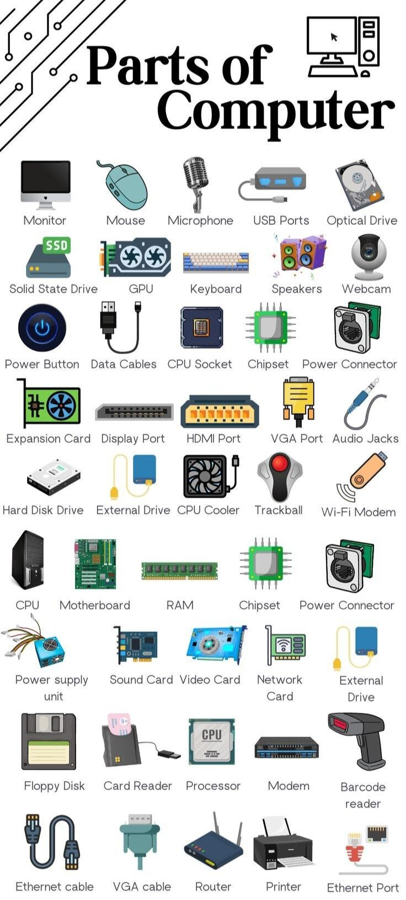
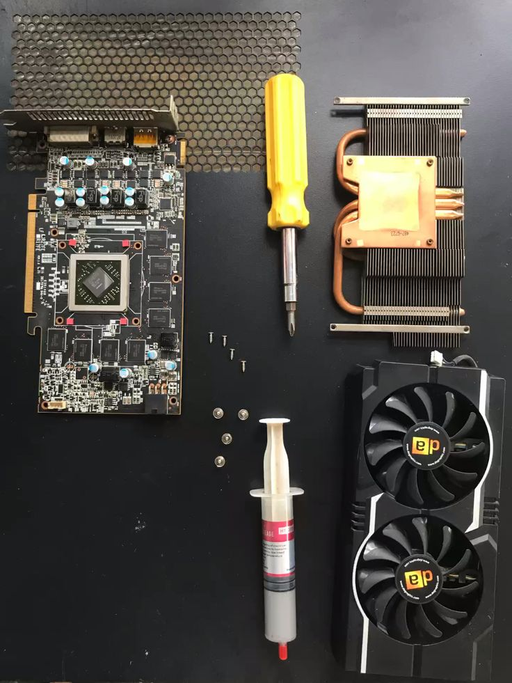
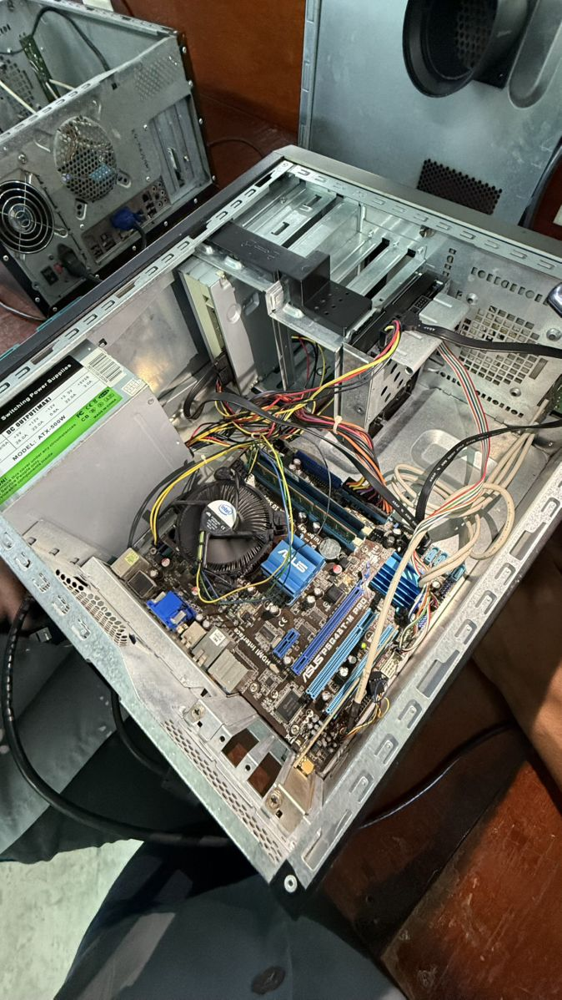

# Lab 02: PC Assembly — Components, Sequence, and Checks

## 1. Overview

This report records my learning about the purpose, components, and safe sequence of desktop PC assembly, based on the original NetAcad Computer Hardware Basics (IT Essentials) PC Assembly Manual in this repository.

**Learning method:** Guided study of the course manual and related reference material. The available record does not confirm that I physically assembled a computer, so the steps below describe procedures studied rather than a completed hands-on build.

## 2. Objective

- Identify the main parts required for a desktop computer.
- Understand basic compatibility checks before assembly.
- Describe a safe, systematic assembly sequence.
- Explain the checks to perform before and after first power-on.

## 3. Tools and Work Area

A typical build may require:

- Phillips screwdriver sized for the case and component screws.
- Small tray or container for screws.
- Clean, stable, well-lit work surface.
- Anti-static wrist strap, or another appropriate ESD-control method.
- The motherboard and case manuals for model-specific instructions.

The exact tools depend on the case and hardware. A screwdriver should be used carefully, and loose screws should be kept away from the motherboard.

## 4. Major Components and Their Roles

| Component | Purpose and assembly consideration |
|---|---|
| Case / chassis | Holds and protects the components; check that it supports the motherboard form factor and required drive or card space. |
| Motherboard | Connects the CPU, memory, storage, expansion cards, and power; install on the correct case standoffs. |
| CPU | Executes instructions; confirm that the processor matches the motherboard socket and supported firmware. |
| CPU cooler and thermal interface | Moves heat away from the processor; follow the cooler instructions and ensure the fan connects to the correct header. |
| RAM | Provides short-term working memory; check the supported memory type and recommended slots in the motherboard manual. |
| Storage (SSD/HDD) | Stores the operating system and files; confirm the drive interface and available mounting or connector options. |
| Power supply (PSU) | Supplies regulated power; choose suitable capacity and connectors, and use only cables intended for that PSU. |
| Graphics card (if required) | Provides display output and graphics processing; check case clearance, slot fit, and any auxiliary power connectors. |
| Case fans and front-panel leads | Support airflow and connect case buttons, indicators, audio, and USB ports to the correct motherboard headers. |

## 5. Safety and Preparation

Before working on a real system, study and follow the component and case manuals. Shut the computer down, disconnect it from mains power, and use suitable electrostatic-discharge precautions. Handle circuit boards and memory by their edges, avoid touching contacts, and never force a connector or component. Do not open a power supply; it can contain hazardous voltages even when unplugged.

Check that the parts are compatible, identify the motherboard standoffs and mounting points, and keep screws organized. If anything does not fit easily, stop and check the manual and alignment.

## 6. Assembly Sequence Studied

The sequence below is a general learning outline. Case and component instructions may require adjustments.

1. **Prepare the case:** Remove the panels, check the standoff positions against the motherboard, and fit the I/O shield if it is separate.
2. **Prepare the motherboard:** Outside the case where practical, install the CPU using the socket alignment marks, apply or confirm the cooler's thermal interface as instructed, fit the cooler, and install RAM in the manual's recommended slots.
3. **Mount the motherboard:** Lower it onto the standoffs without scraping the underside, align the rear ports, and secure it with the correct screws. No extra standoff should touch the board.
4. **Install the PSU:** Place and secure it in the case in the orientation specified by the case design. Route its cables without obstructing fans.
5. **Install storage:** Secure each drive in a compatible bay or slot; connect data and power leads as required.
6. **Install expansion cards:** Use the appropriate slot, secure the card to the case, and connect auxiliary power if the card requires it.
7. **Connect power and case leads:** Connect motherboard and CPU power, storage power/data, cooler and case fans, and front-panel, USB, and audio headers by checking the board manual.
8. **Review routing and close-up:** Check that connectors are fully seated, cables are clear of fan blades, no tools or loose screws remain inside, and the side panel can close without pressure.

## 7. Post-Assembly Checks

Before connecting power, review the build against the manuals: confirm the CPU cooler is secured, the RAM latches are engaged, the motherboard is supported by the correct standoffs, and power connections are seated. Check that fans can spin freely and no cable is trapped.

At first power-on, observe the system for a successful POST or firmware screen, fan operation, and any diagnostic LEDs or beep codes. Confirm that the firmware detects the CPU, memory, and storage. If the system does not start normally, switch it off and disconnect power before inspecting connections. Avoid repeated power attempts if there are signs of a short, unusual heat, smell, or noise.

After hardware checks, the next stages are installing an operating system and drivers, checking device recognition, and monitoring temperatures and stability. These are recommended checks, not results claimed from a physical build in this learning record.

## 8. Reference Images

The repository's existing hardware illustrations are also referenced by the disassembly report. They help identify components and tools; they are reference images, not photographic evidence that I completed an assembly.

## 9. Lessons Learned

- Compatibility and reading the manuals are important before fitting parts.
- A deliberate order reduces the chance of missed connections or obstructed access.
- Components and connectors should align naturally; forcing them can cause damage.
- ESD precautions, power isolation, and careful screw management are part of safe work.
- A build is not complete when the parts are mounted: POST, firmware detection, and stability checks matter.
- My current documentation reflects guided study. I should add dated notes and my own build photographs only after completing and verifying a physical assembly.

## 10. Conclusion

Studying the assembly procedure helped me understand how the case, motherboard, processor, memory, storage, power supply, cooling, and optional graphics card fit together. A physical build remains a separate practical step to document when completed.

---

**Project:** IT & Network Fundamentals  
**Lab:** 02 — PC Assembly  
**Status:** Guided procedure study; physical assembly not confirmed  
**Original course reference:** [NetAcad PC Assembly Manual](1.8.1_lab_pc_assembly_manual.html)