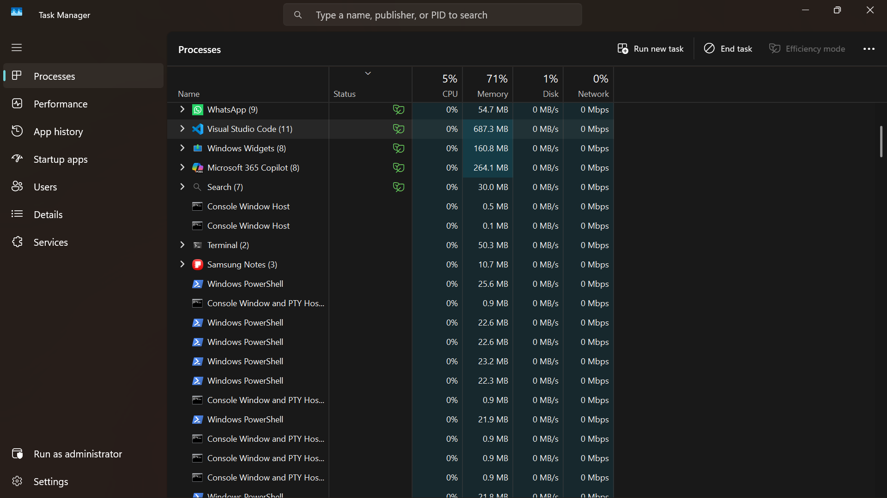
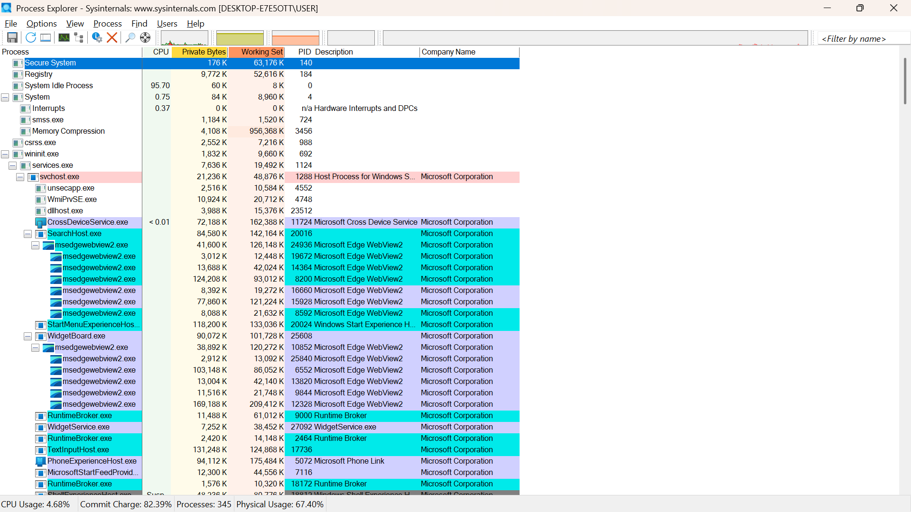
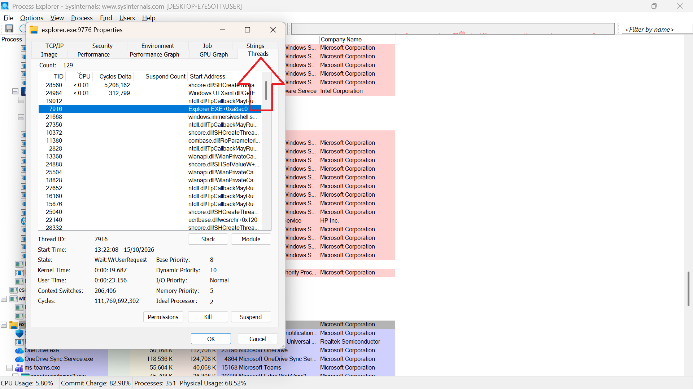
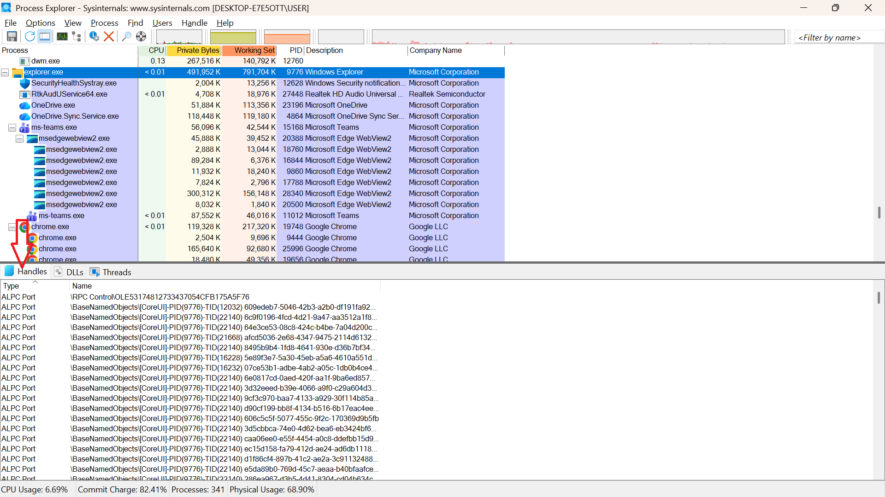
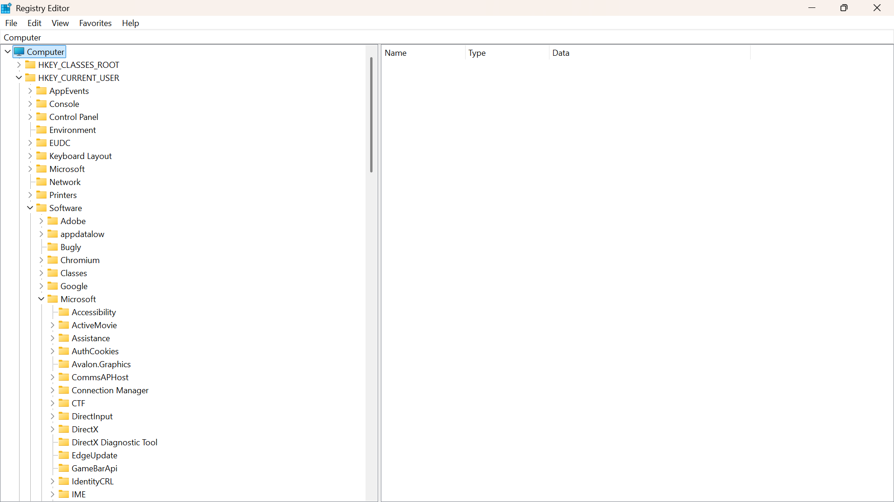

# Lab 03: Exploring Windows Processes, Threads, Handles, and the Registry

## 1. Overview

This lab documents my practical exploration of Windows operating system components using Task Manager, Microsoft Sysinternals Process Explorer, and Windows Registry Editor.

The objective was to understand how Windows manages running processes, threads, system resources, and configuration information.

## 2. Tools Used

- Windows 11 Pro
- Task Manager
- Microsoft Sysinternals Process Explorer (`procexp.exe`)
- Windows Registry Editor (`regedit`)

## 3. Task Manager: Monitoring Processes

Task Manager provides an overview of running applications, background processes, and system resource usage, including CPU, memory, disk, and network activity.

*Figure 1: Windows Task Manager displaying running processes.*

**Observation:** Task Manager provides a convenient way to inspect running applications and monitor their resource usage.

## 4. Process Explorer: Process Hierarchy

Process Explorer provides a more detailed view of running processes, including their parent-child relationships.

*Figure 2: Process Explorer displaying the Windows process hierarchy.*

**Observation:** The process tree helps illustrate how processes can start or manage other processes.

## 5. Exploring Threads

A thread is a unit of execution within a process. A process can contain multiple threads that perform different tasks.

*Figure 3: Threads information inspected in Process Explorer.*

**Observation:** The Threads view provides information about the threads associated with a selected process.

## 6. Exploring Handles

A handle is a reference that a process uses to access an operating system resource or object.

*Figure 4: Handles displayed in Process Explorer's lower pane.*

**Observation:** Process Explorer can display handles associated with a selected process, helping demonstrate how applications interact with system objects.

## 7. Exploring the Windows Registry

The Windows Registry is a hierarchical database that stores configuration settings for Windows and installed applications.

*Figure 5: Windows Registry Editor used to inspect registry keys.*

**Observation:** Registry Editor organizes settings into keys and values. Registry entries should be inspected carefully because incorrect changes can affect system or application behavior.

## 8. Key Learning Outcomes

- Identified the role of Task Manager in monitoring running processes and system resources.
- Explored process hierarchy using Process Explorer.
- Examined thread information for a selected process.
- Viewed handles using Process Explorer's lower pane.
- Explored the Windows Registry and its hierarchical structure.
- Practised documenting technical work using screenshots and Markdown.

## 9. Conclusion

This lab strengthened my understanding of Windows process management, threads, handles, and configuration storage. Using Task Manager and Process Explorer provided practical exposure to operating system monitoring tools, while Registry Editor introduced me to the organization of Windows configuration data.

---

**Project:** IT & Network Fundamentals  
**Lab:** 03 — Windows Processes, Threads, Handles, and Registry  
**Status:** Practical report drafted; screenshots and observations to be verified.