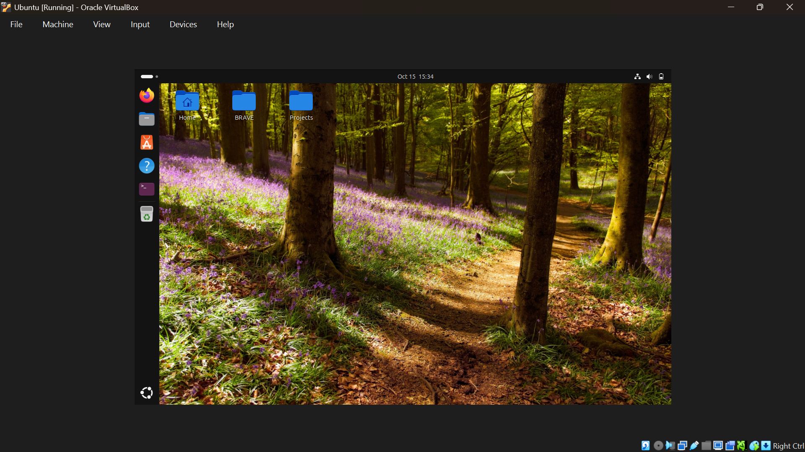
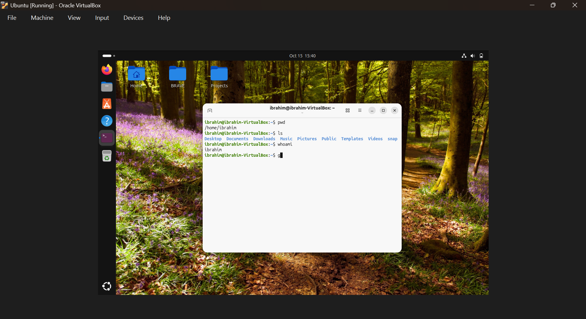
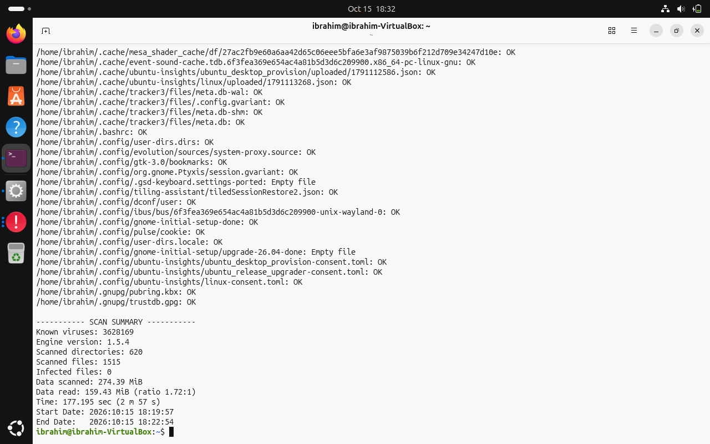
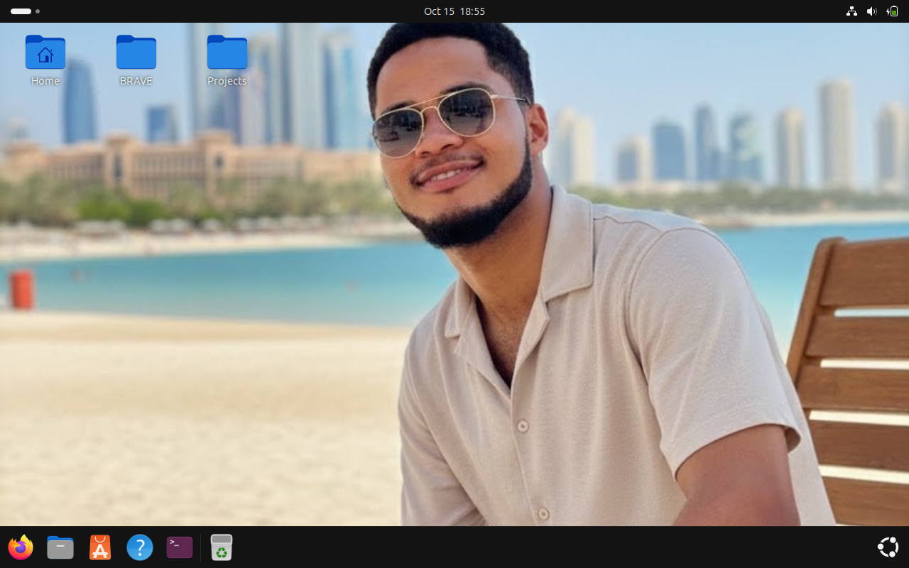

# Lab 04: Ubuntu Virtual Machine and Linux Basics

## 1. Overview

This lab documents my introduction to Ubuntu Linux using Oracle VirtualBox on a Windows 11 host computer. The practical work involved setting up a virtual machine, exploring the Ubuntu desktop, practising basic Linux commands, and performing initial system checks.

This exercise forms part of my ongoing IT and Network Fundamentals learning journey.

## 2. Objectives

- Understand the purpose of virtualization.
- Explore the Ubuntu Linux desktop environment.
- Practise basic Linux terminal commands.
- Create and navigate directories using the command line.
- Observe basic system information and scan results.
- Understand basic virtual machine troubleshooting and account recovery.

## 3. Tools and Environment

- **Host operating system:** Windows 11 Pro
- **Virtualization software:** Oracle VirtualBox
- **Guest operating system:** Ubuntu Linux
- **Terminal:** Ubuntu Terminal
- **Documentation tools:** Visual Studio Code and GitHub

## 4. Virtual Machine Setup

Ubuntu was installed as a virtual machine inside Oracle VirtualBox. This allowed me to explore Linux in an isolated virtual environment without replacing my Windows operating system.

The virtual machine was configured with allocated memory, processors, and virtual disk storage.

*Figure 1: Ubuntu Linux running inside Oracle VirtualBox.*

## 5. Basic Linux Command-Line Practice

I practised using the Ubuntu terminal to understand directory navigation, file listing, and user identification.

| Command | Purpose |
|---|---|
| `pwd` | Displays the current working directory. |
| `ls` | Lists files and directories. |
| `whoami` | Displays the current username. |
| `cd` | Changes the current directory. |
| `mkdir` | Creates a directory. |
| `rm` | Removes files; options and target paths must be used carefully. |

*Figure 2: Basic Linux terminal commands and their output.*

## 6. Directory Management Exercise

I used `mkdir` to create directories and observed them in the Ubuntu desktop environment. I also practised moving between directories using `cd`.

This helped me understand that Linux commands operate relative to the current working directory unless an absolute path is specified.

### Key observations

- `pwd` helps identify the current location in the filesystem.
- `ls` helps inspect the contents of a directory.
- `cd` changes the current working directory.
- `mkdir` creates a new directory.
- `rm` removes files. Removing directories requires additional care and, depending on the directory and command options, may require a different approach.

## 7. Initial System Scan

I performed an initial system scan and captured its output for documentation. The exact checks and findings should be recorded alongside the screenshot after reviewing the commands and results.

*Figure 3: Captured output from an initial Ubuntu system scan.*

## 8. Desktop Customization

I downloaded an image and used it as the Ubuntu desktop background. This provided an opportunity to explore the desktop's personalization settings.

*Figure 4: Ubuntu desktop with a customized background.*

## 9. Troubleshooting Experience

During a later session, the Ubuntu virtual machine became inaccessible in VirtualBox because its configuration file could not be accessed at the expected path.

I located the existing virtual disk and configuration files, restored access to the existing virtual machine, and used Ubuntu's recovery environment to identify my account and reset its forgotten password.

### Commands used during recovery

- `ls /home` — listed home directories to identify the account name.
- `mount -o remount,rw /` — remounted the root filesystem with read/write access in recovery mode.
- `passwd Ibrahim` — reset the password for the identified account.
- `reboot` — restarted the system.

This experience introduced me to recovery mode, filesystem access, and basic Linux account administration.

## 10. Lessons Learned

- VirtualBox allows multiple operating systems to run on one physical computer.
- Linux commands provide direct control over files, directories, and system information.
- The current working directory matters when executing filesystem commands.
- Recovery tools can help restore access to an existing Linux installation.
- Screenshots and written notes provide evidence of practical learning.

## 11. Next Steps

- Continue practising Linux file and directory management.
- Explore Linux users, permissions, and processes.
- Learn how to inspect system resources and network configuration.
- Document each practical exercise with screenshots and observations.
- Link this lab from the main project README.

---

**Project:** IT & Network Fundamentals  
**Lab:** 04 — Ubuntu Virtual Machine and Linux Basics  
**Status:** Initial lab documentation drafted; further practical exercises and scan details to be added.